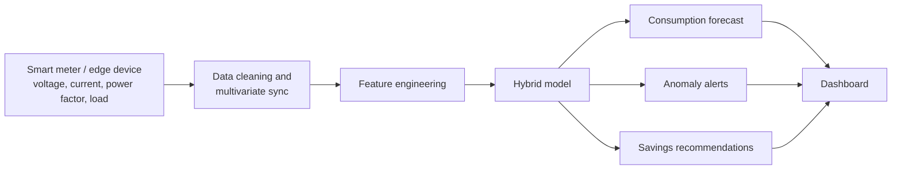
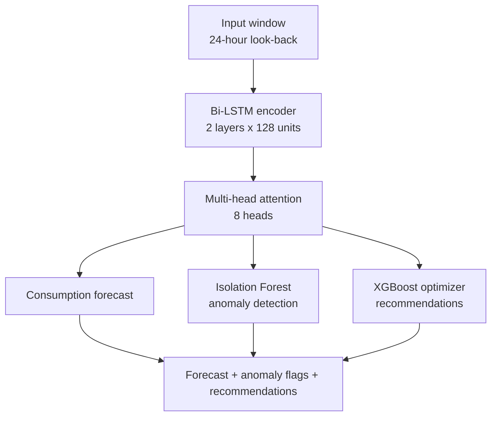

# ⚡ Electricity Consumption Optimizer
### Predicting and reducing household energy waste

**Live demo:** _add your Streamlit link here after deploying_
<!-- Paper reference: add the title / DOI of the published paper here. -->

---

## The idea in one minute

Most households only see a monthly total on their bill. They cannot tell *when* energy is being wasted,
whether an appliance is misbehaving, or what to change in order to pay less.

This project is built around a **smart meter** (or an edge device with a metering chip) that continuously
measures a home's **voltage, current, power factor and load**. The system learns that household's usage
pattern and then does three jobs:

1. **Forecast** upcoming consumption and the resulting bill.
2. **Detect anomalies**: unusual spikes that can point to a faulty or overworked appliance.
3. **Recommend** concrete ways to cut consumption.



## The proposed hybrid model

Four components, each with one job:



| Component | Its job, in plain words |
|---|---|
| Bi-LSTM encoder | Reads the recent history in both directions to learn the household's daily and weekly rhythm. |
| Multi-head attention | Decides which past time steps matter most for the forecast, and makes the model easier to interpret. |
| Isolation Forest | Flags readings that do not look like the household's normal behaviour, without needing labelled faults. |
| XGBoost optimizer | Ranks which factors drive consumption the most, which turns into specific savings advice. |

More detail (problem, goals, step-by-step workflow, hardware, future work): [docs/PROJECT_IDEA.md](docs/PROJECT_IDEA.md)

---

## What exists in this repository today

This repository is a **working prototype** of the idea. Here is how each part compares with the proposed design:

| Part of the idea | Proposed design | In this repository |
|---|---|---|
| Live meter data | Smart meter streams voltage, current, power factor and load | Readings are loaded from a **CSV file** (simulated data, or the UCI household dataset). No live stream yet. |
| Data cleaning | Cleaning and multivariate sync | Done for power (and voltage when present): gaps filled, incomplete days dropped. |
| Forecasting | Bi-LSTM + multi-head attention, 24-hour look-back | **Simplified:** a 2-layer LSTM (64 and 32 units) over a 30-day window of daily kWh. It predicts the next day; the dashboard repeats that to forecast 30 days. |
| Anomaly detection | Isolation Forest | **Simplified:** days above *mean + 2 standard deviations* are flagged. |
| Recommendations | XGBoost feature importance | **Simplified:** rule-based insights calculated from the data (peak hours, always-on load, seasonal peak, weekend use). The assumed saving is shown on each card. |
| Bill estimate | Cost impact of recommendations | Slab tariff (Rs 3.46 / 6.58 / 9.56 per unit). No fixed charges, duty or fuel adjustment. **Check the rates against the current tariff order.** |
| Explainability | Attention weights, SHAP | Not yet implemented. |
| Appliance-level advice | Appliance-specific savings tips | Not yet implemented (needs appliance-level readings). |
| Service layer | Flask/FastAPI back end, SQLite/InfluxDB, React dashboard | Not yet implemented. A **Streamlit** dashboard is used instead. |
| Edge and cloud deployment | Runs on smart-meter class hardware or in the cloud; Docker | Not yet implemented. The trained model can run with NumPy only (`forecast.py`), without TensorFlow. |

### Roadmap

- [x] Data pipeline: cleaning, daily energy, tariff, hourly profile
- [x] LSTM forecasting model and dashboard
- [ ] Multivariate input: voltage, current, power factor
- [ ] Bi-LSTM encoder with multi-head attention
- [ ] Isolation Forest anomaly detection
- [ ] XGBoost optimizer and feature-importance recommendations
- [ ] Live data ingestion (API and database)
- [ ] Docker image and edge deployment

---

## Results of this prototype

Measured with this code on the bundled **simulated** dataset (730 days, last 140 days held out for testing),
predicting one day ahead:

| Model | MAE (kWh) | RMSE (kWh) | MAPE | Accuracy (100 − MAPE) |
|---|---|---|---|---|
| **LSTM** | **1.15** | **1.42** | **2.90%** | **97.1%** |
| Persistence (yesterday's value) | 1.52 | 1.90 | 3.85% | 96.2% |
| Training-set mean | 10.26 | 10.34 | 26.05% | 74.0% |

These numbers describe how well the model learned the simulated data. They say nothing about real homes.
Exact values shift slightly with library versions; `python train_model.py` writes your own to `models/metrics.json`.

---

## Quick start: run the dashboard

Needs Python 3.9 or newer. The trained model and sample data are included, and TensorFlow is **not** needed.

```bash
git clone https://github.com/<your-username>/electricity-optimizer.git
cd electricity-optimizer
python -m venv venv
venv\Scripts\activate          # Windows   (Mac/Linux: source venv/bin/activate)
pip install -r requirements.txt
streamlit run app/dashboard.py
```

Open http://localhost:8501 if the browser does not open by itself.

## Retrain the model

Needs a Python version that TensorFlow supports (see tensorflow.org/install).

```bash
pip install -r requirements-train.txt
python main.py                  # data -> preprocessing -> training -> dashboard
python main.py --no-dashboard   # stop after training
```

Steps one at a time:

```bash
python data/generate_data.py     # simulated hourly data -> data/electricity_data.csv
python data_preprocessing.py     # daily table + hourly profile
python train_model.py            # trains, evaluates, writes models/
streamlit run app/dashboard.py
```

`main.py` never overwrites an existing `data/electricity_data.csv`; use `--regenerate` to replace it.

## Use your own meter data

Put a CSV at `data/electricity_data.csv` in one of these layouts, then run `python main.py`:

* a `datetime` column plus `Global_active_power` (kW), optionally `voltage`; or
* the UCI "Household Electric Power Consumption" file as downloaded (`Date;Time;Global_active_power;...`).

Energy is calculated as power × time for whatever interval your readings use (hourly, per-minute, ...).
Incomplete days at the start and end of the data are dropped. Then **delete `data/DATA_NOTE.txt`** so the
dashboard stops describing the data as simulated. Extra columns named `current`, `power`, `power_factor`,
`frequency` or `run_hours` in `data/daily_clean.csv` are charted automatically; columns that are not
present are simply not shown.

## Deploy on Streamlit Community Cloud (free)

1. Push this repository to GitHub.
2. Go to https://share.streamlit.io and sign in with GitHub.
3. **Create app** → pick the repository, branch `main`, main file path `app/dashboard.py`.
4. Open **Advanced settings** and choose Python 3.11 or 3.12, then **Deploy**.

Only `requirements.txt` is installed there, so the build is quick.

## Project structure

```
app/dashboard.py          Streamlit dashboard
data/generate_data.py     simulated dataset generator
data/daily_clean.csv      daily table read by the dashboard
data/hourly_profile.csv   average usage per hour of day
data_preprocessing.py     loading, cleaning, daily kWh, tariff, sequences
train_model.py            LSTM build / train / evaluate / export
forecast.py               NumPy version of the trained model (used by the dashboard)
main.py                   runs everything
models/                   trained model, NumPy weights, metrics, plots
docs/PROJECT_IDEA.md      the full idea, workflow, hardware and future work
tests/                    pytest checks
requirements.txt          dashboard dependencies
requirements-train.txt    training dependencies
```

## Tests

```bash
pip install pytest
pytest
```

## Authors

A. Nivya Sri, A. Vaishnavi, B. Varsha, Dept. of CSE. Guide: Mr. K. Venkatesh.
