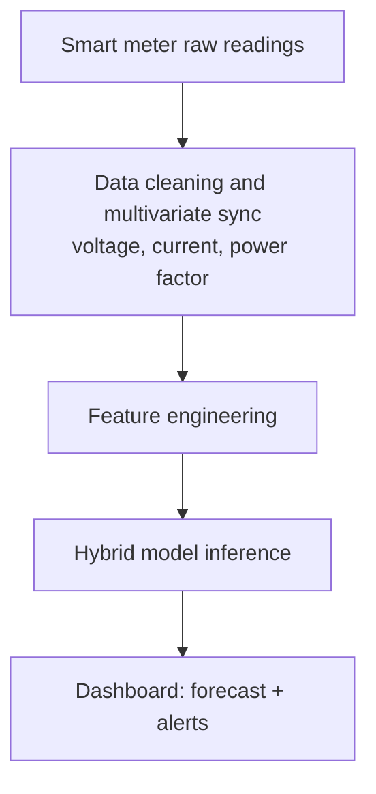
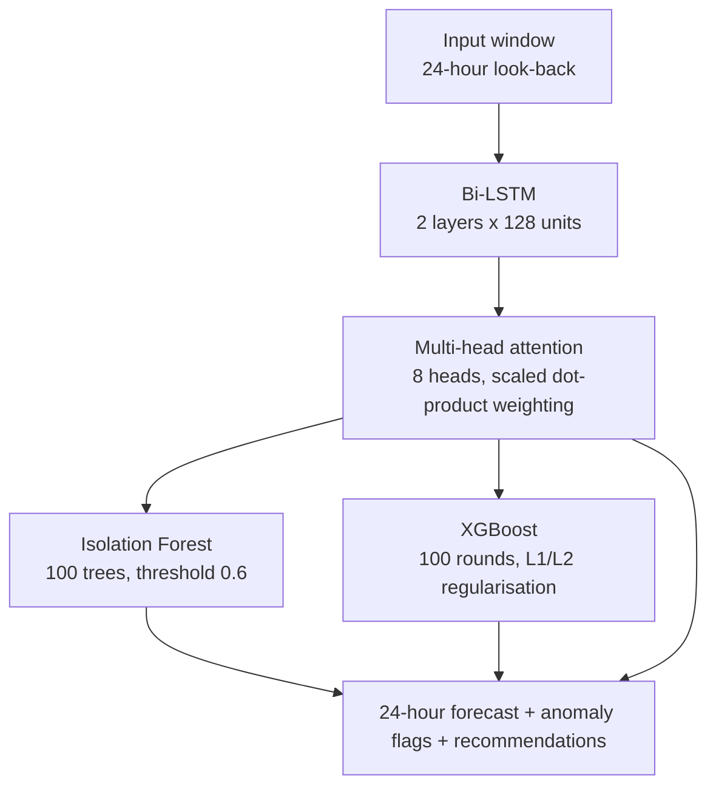

# Project idea: Electricity Consumption Optimizer

*Predicting and reducing household energy waste with a hybrid deep-learning architecture.*

This page explains the whole idea behind the project. The proposed system is larger than the prototype in this
repository; the [status table in the README](../README.md#what-exists-in-this-repository-today) shows what is
built today and what is planned.

## 1. The problem

Homes now run many electronic appliances, and bills rise with them, with seasonal demand and with
inefficient habits. Typical meters and dashboards only report **raw totals**. They do not:

* model how usage changes through the day, the week and the seasons,
* notice abnormal consumption caused by a faulty or overworked appliance,
* turn readings into **advice** a household can act on.

Many existing tools also solve only one task (forecasting *or* anomaly detection) and ignore signals such as
voltage, current and power factor.

## 2. The proposal

A smart meter, or an edge device with a metering chip, measures **voltage, current, power factor and load**
continuously. The system learns each household's pattern and produces:

* a **consumption forecast** (and the bill it implies),
* **anomaly alerts** when usage looks abnormal,
* **recommendations** for reducing consumption without losing comfort.

The five contributions the project aims for:

1. Consumption forecasting with a Bi-LSTM + attention model
2. Unsupervised anomaly detection with Isolation Forest
3. An XGBoost-based optimization and recommendation engine
4. Component-level ablation and robustness analysis
5. Deployment that works on edge hardware or in the cloud

## 3. How it works, step by step

1. **Smart meter onboarding.** The household is registered and its meter data stream is linked.
2. **Data ingestion.** Voltage, current, power factor and historical load are collected.
3. **Feature engineering.** Raw readings are cleaned, synchronised and turned into model-ready features.
4. **Hybrid inference.** The Bi-LSTM + attention model forecasts the next 24 hours of consumption.
5. **Anomaly screening.** Isolation Forest checks incoming readings and raises an alert on abnormal spikes.
6. **Dynamic re-optimization.** As new readings arrive, the XGBoost optimizer updates its recommendations.
7. **Dashboard.** The user sees forecasts, alerts and savings recommendations.
8. **Alerts and tips.** The system sends anomaly alerts and appliance-level savings tips.

## 4. Architecture

### Data flow

### Model pipeline

The settings shown (layer sizes, number of heads and trees) are the **proposed design**. They are not what the
code in this repository uses.

### What each part contributes

* **Bi-LSTM encoder:** recurrent networks capture time dependencies better than classical statistical models;
  reading the window in both directions gives each time step context from before and after it.
* **Multi-head attention:** weights the time steps that matter most, and the weights can be inspected to
  explain a forecast.
* **Isolation Forest:** isolates unusual readings without needing labelled examples of faults.
* **XGBoost:** gradient-boosted trees on tabular features, with feature importance used to decide which
  advice to give.

## 5. Proposed technology and hardware

| Area | Proposed |
|---|---|
| Language | Python 3.8+ |
| Back end | Flask or FastAPI |
| Front end | React.js, HTML, CSS, JavaScript |
| Storage | SQLite, InfluxDB (time series) |
| ML libraries | TensorFlow/Keras, XGBoost, scikit-learn, NumPy, pandas |
| Visualization | Matplotlib, Plotly |
| Interpretability | Attention weights, SHAP |
| Deployment | Docker, edge and cloud |
| Training machine | Intel Core i5 or better, 16 GB RAM |
| Edge inference | ARM Cortex-A / Raspberry Pi 4 class, 512 MB RAM |

**What the prototype actually uses:** Python, pandas, NumPy, TensorFlow/Keras (training only), Streamlit and
Plotly, with CSV files for storage.

## 6. How the prototype relates to this

In this repository the smart-meter stream is replaced by a CSV file, and the hybrid model is replaced by a
simpler LSTM forecaster, a statistical anomaly rule and rule-based recommendations. It shows the end-to-end
shape of the idea (data in, forecast, anomalies, advice, dashboard out) while the harder components are still
to be built. See the roadmap in the README.

## 7. Future enhancements

* **Cross-climate transfer learning:** adapt the model to other climate zones and seasons.
* **Commercial building adaptation:** extend from households to commercial and industrial monitoring.
* **Explainable AI:** SHAP or LIME explanations for every alert and recommendation.
* **Federated learning:** train across households without centralising raw consumption data.
* **Solar PV generation:** include rooftop generation to optimise net consumption.
* **Mobile apps:** Android and iOS apps for alerts, forecasts and recommendations.
* **Utility-grid integration:** demand-response programmes and dynamic-pricing alerts.

## 8. References

* Kong, W. et al. (2019). Short-Term Residential Load Forecasting Based on LSTM Recurrent Neural Network. *IEEE Transactions on Smart Grid*.
* Vaswani, A. et al. (2017). Attention Is All You Need. *NeurIPS*.
* Liu, F. T., Ting, K. M., & Zhou, Z.-H. (2008). Isolation Forest. *IEEE International Conference on Data Mining*.
* Chen, T. & Guestrin, C. (2016). XGBoost: A Scalable Tree Boosting System. *ACM SIGKDD*.
* International Energy Agency (2023). Digitalisation and Energy Efficiency in Buildings. *IEA Reports*.
